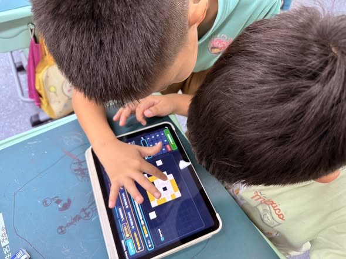
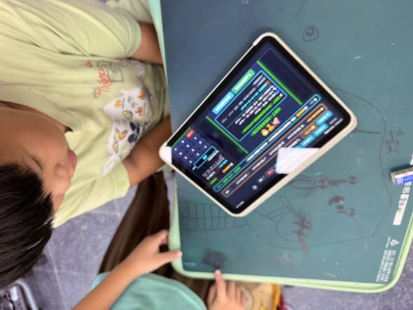
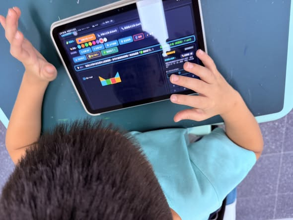
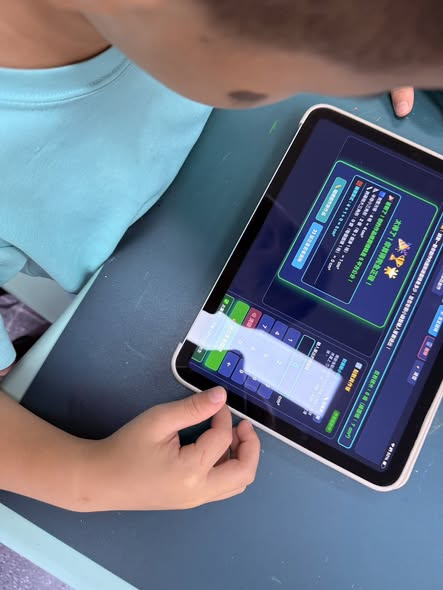
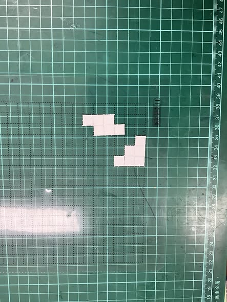

# 📐📱 小三面積「說數學」：從實體 1 平方公分到 iPad 螢幕校準與切割拼湊探究

`#教學日誌` `#屏科實中國小部` `#說數學` `#小三面積` `#20262027蘋果種子教師計畫`

---

> 📘 完整課堂照片與原始貼文紀錄，請見：[敬修老師 Facebook 原貼文](https://www.facebook.com/jing.siou.lin/posts/pfbid0k2nF94khBDshayz59H5Cp9feSj1RKaW2rJ4dVx8rdrUEyacG7onuRJNbPVzcMdwRl)

在教國小三四年級「面積」單元時，我們常發現孩子以為面積就是「長 × 寬」，但實際根本不是這樣！！！

其實，「面積」的本質不是死背乘法，而是孩子能不能在腦中建立「覆蓋」的「真實量感」。

這堂課，我們透過「實體操作」與「自製數位互動教具」的無縫銜接，鎖定三個關鍵教學目標：

---

### 🎯 本堂課三大教學目標
1️⃣ **認識 1 平方公分**：建立標準面積單位的具體量感。
2️⃣ **等積異形初探**：理解「形狀改變，但只要佔據的方格數不變，面積就守恆」。
3️⃣ **切割拼湊算面積**：學會平移、旋轉、補湊，把複雜圖形化繁為簡。

---

### 🔍 課堂精彩亮點：從桌面到平板的奇妙體驗

#### 🔹 第 1 步｜手握實體 1 平方公分，發現「等積異形」的秘密
孩子們先認識什麼是 1 平方公分後，接著在桌墊上動手排 6 個 1 平方公分小方格：一字排開是「長條形」、擺成兩排是「長方形」、排成高低不齊是「階梯形」……孩子驚喜地發現：「形狀長得完全不同，但數一數都是 6 個小方格，所以它們面積根本一樣大！」

#### 🔹 第 2 步｜超貼心的教具細節「螢幕尺寸校準」
當孩子拿出平板打開互動網頁時，第一件事不是做題目，而是點擊【校準】功能！很多數位工具最怕「螢幕上的格子脫離真實」。透過校準，學生在 iPad 螢幕上看到的方格，拿尺去量就是實體「真正的 1 平方公分」！孩子剛才在桌上摸到的手感，無縫複製到了螢幕上，讓數位學習完全不失真。

#### 🔹 第 3 步｜指尖上的幾何魔術——「切割與拼湊」
遇到斜邊三角形和半格怎麼算？孩子們兩兩湊在平板前，興奮地拖曳、旋轉 90 度、水平翻轉：
「老師！這兩個 0.5 平方公分的小三角形轉一下拼起來，剛好就是 1 格！」
「把突出來的小角切下來，移過去補進凹槽，就變成整齊的形狀了！」

---

### 💡 教學心得
學幾何，最怕直接跳進符號與公式。從「具體實物（握在手裡）」➔「半具體表徵（校準後的數位動態操作）」➔「抽象概念（切割互補求面積）」，孩子親手證明的道理，一輩子都不會忘記！看著孩子們並肩靠著頭、專注討論的模樣，這正是探究式數學最動人的時刻。

---

### 🛠️【好教具免安裝分享】
本單元使用的「面積概念實驗室」互動網頁（含 1:1 實體尺寸校準功能），開放給所有老師與家長免費使用，手機、平板、電腦點開即可操作：

* 🔗 互動教具傳送門：[面積概念實驗室](../../tools/area_concept_lab.html?v=20261119)
* 📘 原貼文連結：[敬修老師 Facebook 貼文](https://www.facebook.com/jing.siou.lin/posts/pfbid0k2nF94khBDshayz59H5Cp9feSj1RKaW2rJ4dVx8rdrUEyacG7onuRJNbPVzcMdwRl)
