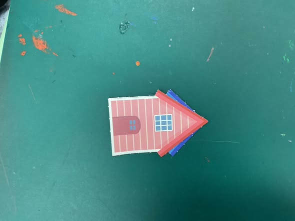
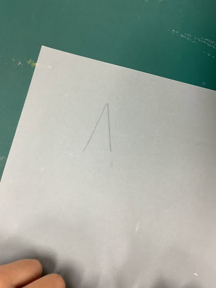
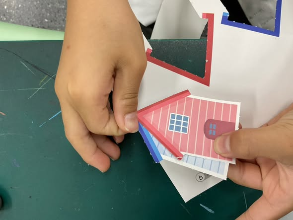
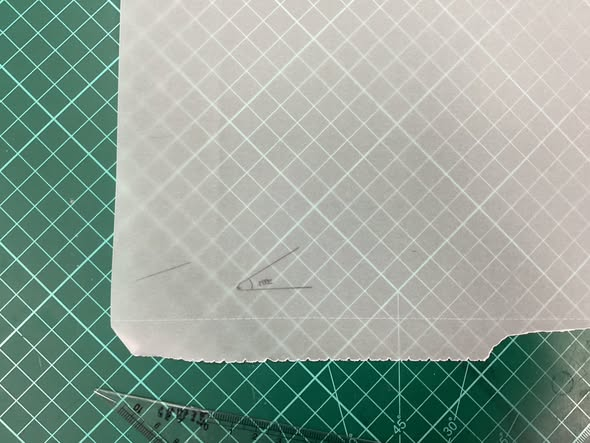
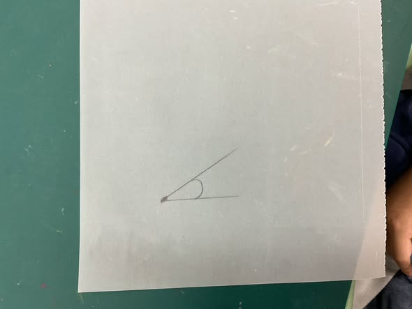

# 📐✨【把抽象的角「動」起來！三年級數學公開授課手記：當自製互動教具遇上描圖紙的指尖溫度】

`#教學日誌` `#屏科實中國小部` `#說數學` `#公開授課` `#三年級角`

---

> 📘 完整課堂照片與原始貼文紀錄，請見：[敬修老師 Facebook 原貼文](https://www.facebook.com/jing.siou.lin/posts/pfbid0RDt5jrM3Xwim7QncG2upgZrdUPjfDFL4DWBxJwqD45PBv6mA3CKybq1i6yhDz2E2l)

「老師！我們描明明是同一個角，為什麼他的邊那麼長、我的那麼短？這樣到底哪一個比較大？」

「老師，我的頂點好像畫得圓圓鈍鈍的，這樣還算是角嗎？」

孩子們一手壓著尺、一手拿著鉛筆，在半透明的描圖紙上熱烈比劃著。那一張張認真探索、急於解開心中疑惑的小臉龐，正是教室裡最動人的風景。🌱

---

### 📐 三年級孩子學「角」，最難跨越的迷思是什麼？

在大人眼中，「角的大小就是兩邊張開的程度」，看似自然；但對三年級的孩子來說，他們的視覺極容易被「邊的長短」所干擾——「邊畫得比較長，角不就看起來比較大嗎？」

為了讓這群剛踏入幾何世界的小小探險家能真正「看見」角的本質，今天的公開授課，我設定了兩個核心目標：
1️⃣ 認識圖形角、張開角及其構成要素（頂點與邊）
2️⃣ 學會比較角的大小（本節僅處理直接比較）

這堂課，我不急著給答案，而是透過「描圖紙的動手實作」與「自製數位動態教具」，讓孩子在畫角與思辨中親自碰壁、討論、頓悟！

---

### ✨ 課堂上的四大活動紀錄

#### 🔹 1. 描圖紙上的「畫角大偵探」：澄清邊長長短與頂點的秘密
活動一開始，全班練習在半透明描圖紙上描出同一個角。畫完一比對，全班立刻炸開了鍋——
「咦？明明描同一個角，為什麼有人畫的邊好長、有人畫的邊短短的？到底誰的角比較大？」
藉由這個真實的操作差異，我們展開了一場精彩的思辨對話！
孩子們也在相互檢視中發現細節：描角時「頂點」到底是尖的還是鈍的？

我適時引導提醒孩子描角的關鍵密碼：兩條邊必須是筆直的線，相交的地方一定要精準收在「尖尖的頂點」上，既不能分岔、也不能畫成圓弧鈍鈍的。從動手畫角中，孩子們親自提煉出角的標準樣貌！

#### 🔹 2. 大螢幕上的自製互動網站：破解邊長迷思的神助攻
解決了頂點與畫法，那「邊畫得長，角到底有沒有變大？」
這時我打開自己編寫的數學互動教學網頁，在觸控大螢幕上將角的兩條邊「咻——」地往外拉伸延伸。
全班屏息凝神，我問：「邊拉長了，角變大了嗎？」
看著依然重疊的角弧（角的張開程度），孩子們紛紛開竅大喊：「沒有！因為兩條邊張開的嘴巴大小根本沒有變！」
抽象的「張開角」概念，在大螢幕的動態視覺化輔助下，瞬間化為直觀深刻的認知！

#### 🔹 3. 紅藍小房子的屋頂大對決：動手疊合的直接比較
「北歐常常下雪，哪一間房子的雪最容易滑下來？」
有了前段的精準概念，孩子們撕下課本附件的紅色與藍色小房子圖卡，兩兩動手把尖尖的屋頂貼在一起——
「頂點對頂點、一邊對一邊！」
看著另一條邊落在外面還是裡面，孩子自信地喊出：「藍色房子的屋頂角比較大！」從手部肌肉的對齊動作，真正建構出幾何「直接比較」的策略與嚴謹度。

#### 🔹 4. 開口大小實驗室：動態拖曳再次印證「點對點、邊對邊」黃金口訣
紙卡操作完後，如何把這個手感技巧牢牢刻進大腦？
我切換到互動網頁的「開口大小實驗室」，大螢幕上出現了橘色的角與青色的角。
「請抓著【青色角】頂點，拖過來和【橘色角】的頂點疊合！」
當孩子伸出手指在螢幕上拖曳角 2，兩角頂點一靠近便瞬間「自動磁吸對齊」！全班跟著節奏齊聲複誦關鍵口訣：

👉 **「頂點對頂點、一邊對一邊！」**
兩角底邊緊緊重合，另一條邊張開的角度差立刻無所遁形。從指尖拖曳到動態磁吸，科技工具再次強力印證了直接比較的核心準則，把幾何操作昇華為不可動搖的直覺！

---

### ❤️ 教與學的對話，教育最美的風景
40 分鐘的課堂過得飛快，看著孩子從最初對邊長長短的困惑、對頂點鈍尖的討論，到最後能自信流暢地說出比較角的步驟與規則，那份思維躍升的喜悅無可取代。

---

### 🔗 相關連結
* 🛠️ 課堂互動教具：[角的概念實驗室](../../tools/angle_concept_lab.html?v=20261110)
* 📘 原貼文連結：[敬修老師 Facebook 貼文](https://www.facebook.com/jing.siou.lin/posts/pfbid0RDt5jrM3Xwim7QncG2upgZrdUPjfDFL4DWBxJwqD45PBv6mA3CKybq1i6yhDz2E2l)
